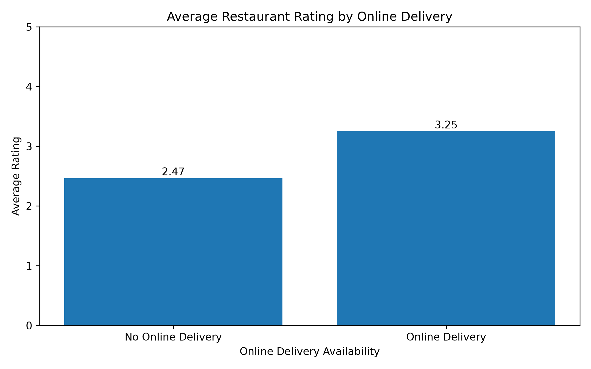

Restaurant Online Delivery Analysis

Cognifyz Technologies — Data Analytics Internship

This project analyzes online food delivery availability and restaurant ratings using the Zomato dataset.

Tools Used

- Python
- Pandas
- Matplotlib
- Jupyter Notebook

Key Findings

- Restaurants offering online delivery: 25.66%
- Restaurants not offering online delivery: 74.34%
- Average rating with online delivery: 3.25
- Average rating without online delivery: 2.47

Visualizations

1. Online Delivery Availability

.png)

This chart compares the percentage of restaurants that offer online delivery with those that do not.

2. Average Rating Comparison

Restaurants offering online delivery have a higher average rating (3.25) than restaurants without online delivery (2.47). This shows an association in this dataset, not proof that delivery causes higher ratings.

Files Included

- "Cognifyz_Online_Delivery.ipynb" — analysis notebook
- "Online_Delivery_Percentage.png" — delivery availability chart
- "Online_Delivery_Rating_Comparison.png" — rating comparison chart
- "Online_Delivery_Results.csv" — analysis results

Conclusion

In this dataset, approximately one in four restaurants offers online delivery. Restaurants offering online delivery also have a higher average rating. Restaurants may investigate online delivery as a way to improve customer convenience and experience.

Methodology

The dataset was loaded using Pandas. Restaurants were grouped by online delivery availability, percentages were calculated, and average ratings were compared. Matplotlib was used to create the visualizations.

Internship

Organization: Cognifyz Technologies

Project: Data Analytics Internship

Task: Online Delivery Analysis
